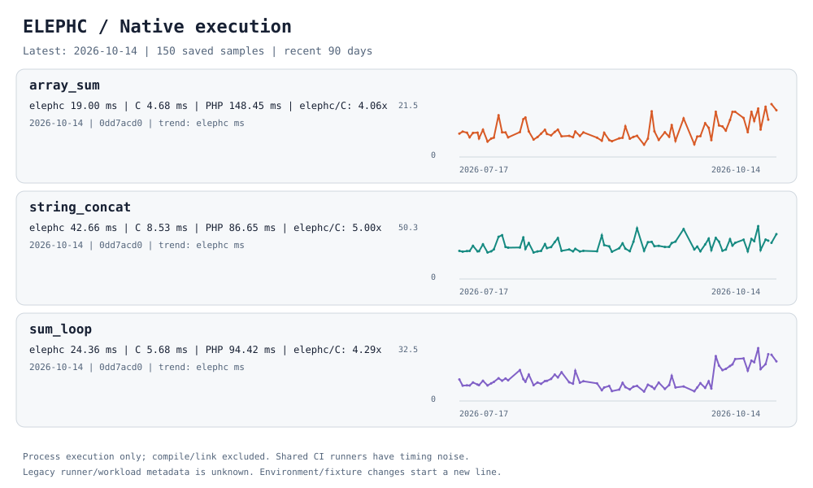
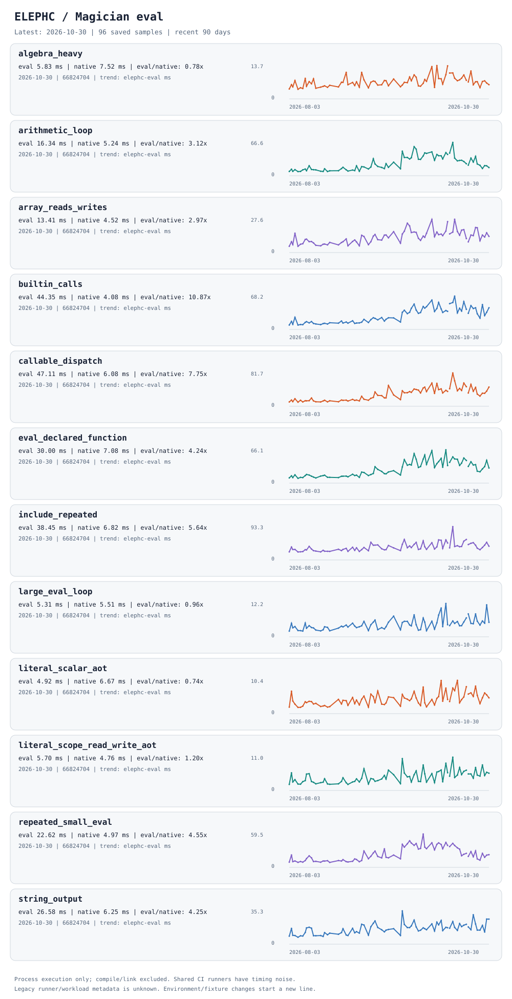
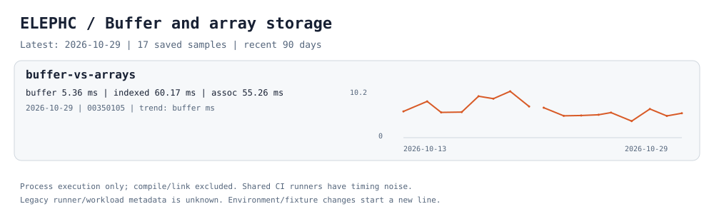

# Benchmarks

All benchmark fixtures, runners, saved CI histories, and reports live here.
The process suites use one runner and the same versioned JSON format:

| Suite | Workload | Variants |
|---|---|---|
| `native` | Integer sum, array reads, string concatenation | elephc, PHP, equivalent C (`-O2`) |
| `magician` | Literal/dynamic eval, arithmetic, arrays, builtins, callables, includes | elephc native/eval, PHP native/eval |
| `hot-path` | Equivalent position updates through different storage | elephc buffer, indexed array, associative array |

## Running

```bash
python3 benchmark/run.py --list
python3 benchmark/run.py --suite all
python3 benchmark/run.py --suite native --case sum_loop --iterations 7 --warmup 2
python3 benchmark/run.py --case magician/arithmetic_loop --json results.json --markdown results.md
```

The runner asks Cargo to refresh the release compiler before measuring, even if
the binary already exists. `--no-build` reuses a compiler built immediately
beforehand, as CI does. `--compiler PATH` selects an explicitly managed compiler
without building. Neither mode rewrites the selected compiler.

`--require-baselines` fails before building if PHP or a C compiler needed by the
selected cases is missing. CI enables this flag and explicitly installs PHP 8.5
without coverage drivers. Local runs can still skip unavailable comparison tools.

PHP, elephc, and C are measured again in every CI run. Each case gets one warmup
and three measured executions in CI; PHP results are not cached between runs.

Each fixture is copied to a temporary directory, each native variant is compiled
once, and only repeated process execution is timed. Every warmup and measured
execution must produce `expected.txt` exactly. Temporary sources and binaries
are removed on success and failure. Use `--timeout SECONDS` to bound individual
compilation/execution commands (default: 120 seconds).

Missing PHP or C tools appear as skipped baselines, never zero times. PHP CLI
OPcache and JIT are explicitly disabled for new measurements. The compiler,
Rust, C, PHP, runner, architecture, iterations, warmup, and fixture hash are
recorded with available raw samples. A result's commit identifies the measured
source, not the later statistics publication commit.

The hot-path variants include initialization and final checksum computation in
their process time. They replace the former combined in-process stopwatch and
have no historical series until the first CI run using this harness.

## Reports and dashboard

Native medians and recent trends:

<picture>
  <source media="(prefers-color-scheme: dark)" srcset="assets/native-dark.svg">
  
</picture>

<details>
<summary>Magician native/eval measurements</summary>

<picture>
  <source media="(prefers-color-scheme: dark)" srcset="assets/magician-dark.svg">
  
</picture>

</details>

<details>
<summary>Buffer and array storage measurements</summary>

<picture>
  <source media="(prefers-color-scheme: dark)" srcset="assets/hot-path-dark.svg">
  
</picture>

</details>

```bash
python3 benchmark/dashboard.py
python3 benchmark/dashboard.py --port 9000 --no-open
python3 benchmark/report.py
```

The dashboard runs on localhost and works offline, without CDN dependencies.
Choose a suite, time window, or absolute/relative metric; hover a point for its
commit and measured environment. SVG reports are deterministic and work directly
in GitHub README files, with light/dark variants. The root README embeds the
native report and links here for the other suites.

## CI and saved history

The existing `Benchmark Suite` job runs on pushes to `main`, using the release
compiler on `macos-15`, three measured executions and one warmup. It uploads one
`benchmark-results` artifact containing `results.json` and `results.md` for all
three suites. PRs run focused tooling tests and the normal fixture correctness
tests; they do not append performance samples to the product history.

Historical native and Magician artifacts have no PHP timings because the old
macOS job did not install PHP. Those values cannot be recovered by fetching the
old artifacts again. New CI runs calculate the PHP baseline once with
OPcache/JIT disabled in each run and record its installed version.

The first available PHP measurement also supplies a reference for earlier points
that lack PHP timings. Reports use this reference to fill historical gaps. The
raw `median_ms` remains null; a separate `reference` records the value, PHP
version/environment, fixture hash, source commit/run, and measurement timestamp.
It is an estimate for historical comparisons, not a PHP execution from that
date. The dashboard draws reference segments with a dashed line and shows their
origin on hover. Known platform or fixture mismatches are never backfilled. Unknown legacy
metadata can use the first available reference. Existing PHP measurements and
references are preserved; each new CI run adds its own freshly measured PHP data.

The existing nightly `Repository Stats` workflow fetches available benchmark
artifacts, merges them into `data/{native,magician,hot-path}.json`, regenerates
`assets/*.svg`, and publishes them together with repository statistics. It uses
the existing Illegal Bot installation identity for a `[skip ci]` commit. Artifact
reads use an Actions-read workflow token. Publication uses an isolated checkout
of current `main`; concurrent updates trigger another merge and normal push,
without changing the source checkout or force-pushing.

Each suite keeps the latest sample per **UTC artifact-upload day and platform**.
A newer run can replace the existing sample for that day. Older dates remain
saved after artifact expiry. Selection happens after reading each artifact's
suite and platform. `data/imports.json` checkpoints sample metadata for each
artifact, so unchanged or superseded artifacts and legacy archives lacking
newer suites are not downloaded again every night. Fetch failures or malformed
saved results fail the refresh before replacing any history.

Manual refresh:

```bash
python3 benchmark/fetch.py
python3 benchmark/report.py
```

`fetch.py` imports both the original native/Magician artifact formats and the
new shared format. It filters artifacts by name, branch, expiry, and repository
origin. Use `--repo owner/repo` explicitly when needed. A different branch or
`--all-runs` sampling requires a separate `--out-dir`, preserving the main daily
history's meaning. No destructive rebuild option is provided.

Legacy native points were migrated with their timing values intact, including
expired artifacts. Available Magician history was recovered too. Legacy samples
lack runner/toolchain/fixture metadata and some raw samples; these fields remain
unknown rather than inferred. New environment or fixture versions start a new
plot segment. Hosted runner results describe trends, not universal performance
claims or hard regression thresholds. Eval/native ratios include process startup,
and eligible literal eval fragments can be AOT-lowered; fragment metadata in the
Magician history explains each case's intended path.

## Internal measurements

Rust stopwatches that require private compiler/interpreter APIs retain their
owning test modules, with commands exposed through the same entry point:

```bash
python3 benchmark/run.py --internal script-cache
python3 benchmark/run.py --internal null-representation
```

These manual measurements have different scopes (including parse/deserialize or
compile/link time). They do not join the process-execution histories or run in
the trend CI job.

## Tooling checks

```bash
python3 -B -m unittest discover -s benchmark/tests -v
python3 -B benchmark/report.py
git diff --check
```

Tests cover expired-history migration, later samples on the same day, reruns,
multiple platforms/suites, skipped baselines, invalid data, deterministic SVGs,
offline dashboard embedding, and publication racing against a newer main commit.
