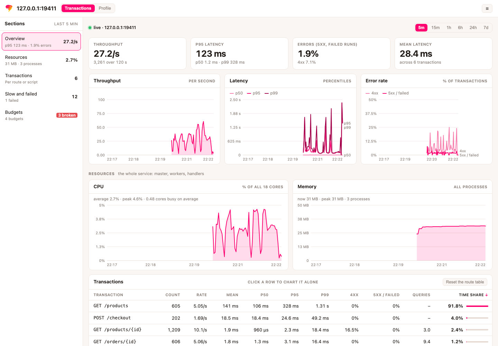
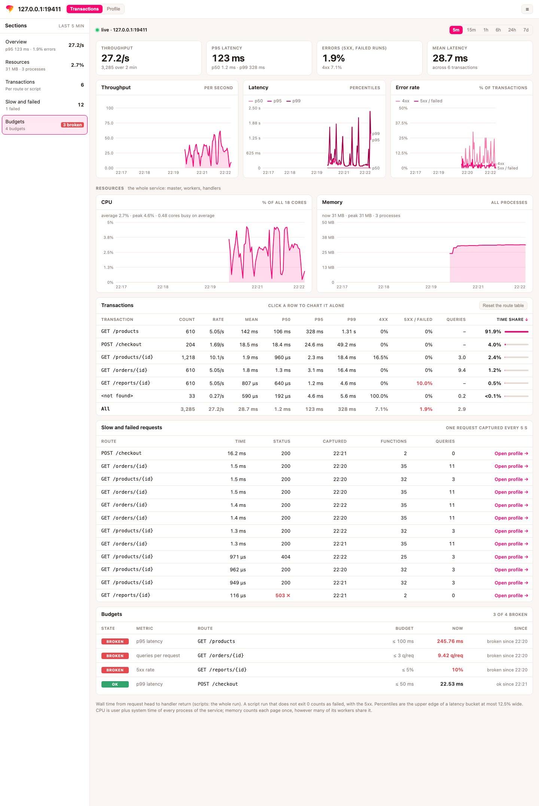
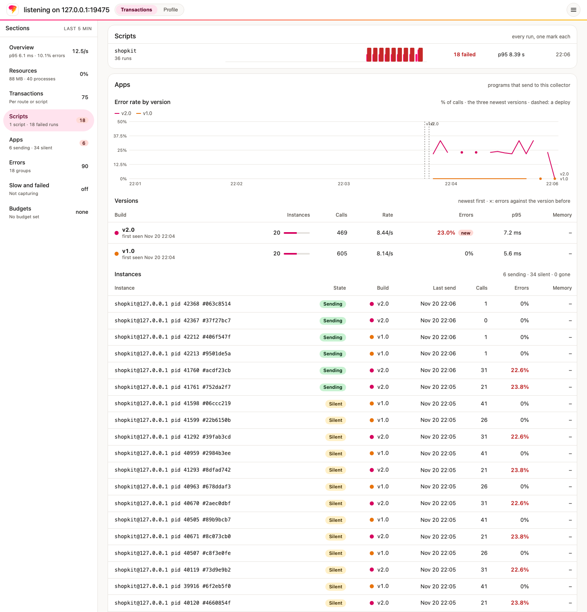

[Profiling](profiling.md) tells you where one request spends its time.
Transaction monitoring tells you which routes and jobs are slow, failing or busy, and since when.

It counts every request of a `--web` service, per route, from the moment the service starts.
It counts every run of a script launched through `monitor`.
It also counts [messages, library calls and named boundaries](#beyond-http-messages-library-calls-named-boundaries).
`elephc monitor --apm` shows the result as a table, a live terminal view, a history on disk and a Transactions view on the monitor page.

## Start in three commands

A `--web` service:

```bash
elephc build --web --with-monitoring shop.php
ELEPHC_PROBE_ADDR=127.0.0.1:9411 ./shop --listen 0.0.0.0:8080 --apm

elephc monitor 127.0.0.1:9411 --apm --key shop.key \
    --store /var/lib/shop-apm --serve 127.0.0.1:9000
```

A script, such as a cron job or a console command. `monitor` launches it and records the run:

```bash
elephc monitor bin/console --apm --store /var/lib/shop-apm -- app:import --force
```

A program that pushes its counters to a collector:

```bash
elephc build --with-apm --apm-collector 10.0.0.5:9412 bin/console.php
elephc monitor --apm --listen 0.0.0.0:9412 --key console.key --store /var/lib/shop-apm
```

`examples/web-apm/demo.sh` starts a small shop API and sends it traffic. Open the page and watch it fill. `examples/apm-apps/demo.sh` does the same for programs that send to a listening collector: two versions of a worker, for the Scripts and Apps sections.

## Turn it on

| Where | What | Effect |
|---|---|---|
| Build | `--with-monitoring` | Carries monitoring and the profiler. |
| Build | `--with-apm` | Carries transaction monitoring alone: no instrumentation, no sampling signal. |
| Run | `--apm` | A runtime argument of the produced binary. Without it, a monitored service counts nothing. |
| Project | `elephc.toml` | Sets the build side once for every build. |

A binary without monitoring refuses `--apm` with exit code 2.
It does the same when its shared counters could not be mapped at startup.
If `--apm` is missing at run time, `monitor --apm` tells you which flag to add.

### In the project file

The build flags can live in `elephc.toml`, next to the [`[ini]` directives](../compiling/cli-reference.md#in-the-project-file) and the [native dependencies](../compiling/native-dependencies.md).

```toml
[monitoring]
# enabled = true                  # --with-monitoring
functions = ["App\\Checkout::*"]  # --with-monitoring=App\Checkout::*

[apm]
enabled = true                    # --with-apm
collector = "10.0.0.5:9412"       # --apm-collector
transactions = ["App\\Jobs\\Import::run"]  # --apm-transaction, repeatable
exclude = ["GET /health", "GET /_profiler/*"]

# One entry file of the project, monitored its own way.
# Its keys replace the project's. The others stay.
[entry."bin/console".apm]
exclude = ["CLI console cache:*", "CLI console messenger:stats"]
```

- elephc reads the nearest `elephc.toml` above the compiled PHP file and prints a note about what it turned on.
- The command line wins. The file only fills what the command line left unset.
- `[entry."<path>"]` applies to the build whose entry file is that path, relative to the file's directory. Use it for a web front and a console in one project. A path that names no file, such as a typo, prints a warning on every build.
- `functions`, `collector` and `transactions` each turn their table on. An explicit `enabled = false` wins over them, so an entry can switch monitoring off without deleting its keys.
- A library build skips `[monitoring]`. A PHP extension skips `[apm]`. Each prints a note, not an error.
- An unknown key, an invalid collector or an invalid transaction name fails the compile with a message naming the file.

### Choose what is counted

Skip the noise: a health check, a debug toolbar, a cache-warming command.

```toml
[apm]
include = ["GET /api/*", "CLI console app:*"]  # count only these
exclude = ["GET /api/ping"]                    # except this one
```

- `exclude` lists what is never counted.
- `include`, when present, narrows counting to what it names. `exclude` then carves exceptions out of it.
- A pattern matches a transaction's whole name as the tables show it: `GET /health`, `CLI console cache:clear`, `MSG App\Message\Ping`, `TXN ...`, `CALL ...`.
- `*` stands for any run of characters. Case is kept.
- An excluded transaction counts nothing: no row, no budget, no in-flight tracking, no queries, no automatic capture. A `monitor --exact` you run yourself still profiles it.
- A counted transaction run inside an excluded one, such as a message handled during an excluded command, is still counted, also while a sampled profile is being taken.
- The rules are part of the build. Changing them means building again.

## Watch it

```bash
elephc monitor 127.0.0.1:9411 --apm --key shop.key
```

```text
transactions since the service started — 555 requests over 20.8 s, 7 routes

service: CPU 4.2% of 18 cores (0.76 busy) · memory 13.0 MB · 3 processes

route                   req    req/s      mean       p50       p95       p99    4xx    5xx   time  q/req   wait
GET /products           102      4.9  135.0 ms  122.9 ms  213.0 ms  327.7 ms   0.0%   0.0%  91.9%    0.0   0.0%
POST /checkout           35      1.7   18.1 ms   18.4 ms   30.7 ms   41.0 ms   0.0%   0.0%   4.2%    0.0   0.0%
GET /products/{id}      204      9.8    1.4 ms    1.2 ms    3.8 ms    6.1 ms  13.2%   0.0%   2.0%    3.0  32.7%
GET /orders/{id}        102      4.9    1.9 ms    1.5 ms    2.8 ms   11.3 ms   0.0%   0.0%   1.3%    9.4  22.4%
GET /reports/{id}       103      5.0  785.1 µs  768.0 µs    1.2 ms    2.8 ms   0.0%  10.7%   0.5%    0.0   0.0%
<not found>               8      0.4  920.8 µs  224.0 µs    5.1 ms    5.1 ms 100.0%   0.0%   0.0%    0.8  17.2%
GET /                     1      0.0    1.9 ms    1.9 ms    1.9 ms    1.9 ms   0.0%   0.0%   0.0%    0.0   0.0%
all routes              555     26.7   27.0 ms    1.3 ms  147.5 ms  213.0 ms   6.3%   2.0% 100.0%    2.8   0.9%

wall time from request head to handler return; percentiles are the upper edge of a latency bucket at most 12.5% wide
```

This is `examples/web-apm` under its demo load.
Rows are ordered by share of total wall time, so the top row is where an optimization pays.
Here the catalogue listing takes 92% of the service's time.
The payment call is slower per request but takes 4%.

The key, the endpoint address and the transport (`host:port`, `https://`, a Unix socket path) work as for [profiling a running service](profiling.md#profiling-something-that-is-already-running).

### Live, in the terminal

```bash
elephc monitor 127.0.0.1:9411 --apm --live --duration 5 --route "GET /products"
```

- The collector polls the service once a second.
- `--live` redraws the table for the last `--duration` seconds (default 3) until Ctrl-C.
- Under the table you get the trends of the last minute: throughput and p95 per route as sparklines, with their peak and worst value.
- A stretch the collector did not see is a blank, not a zero.

```text
trends over the last 10 min (oldest → newest)

route               req/s                          peak  p95                           worst
GET /products       ▇▇▅█▄▇▆▆▇▄▆▅▅▆▄▆▄▆▆▅▆▄▆▄       19.6  ▅▅▅▅▅▆▅▅▆▆▆▆▆▇▇▆█▆▆▇██▇█    73.7 ms
POST /checkout      ▇▇▅█▄▇▆▆▇▄▆▅▅▆▄▆▄▆▆▅▆▄▆▄        6.5  ▇▇▇▇▇█▇▇▇██▇▇█▇▇█▇▇▇██▇█    18.4 ms
```

`--route <label>` adds that route's latency distribution, one row per power of two:

```text
latency of GET /products — 8484 requests

  16.4 ms – 32.8 ms   █                                             21   0.2%
  32.8 ms – 65.5 ms   ████████████████████████████████████████    8317  98.0%
  65.5 ms – 131.1 ms  █                                            142   1.7%
 131.1 ms – 262.1 ms  █                                              4   0.0%
```

The same view works over a stored history, with no service and no browser:

```bash
elephc monitor --apm --store /var/lib/shop-apm --duration 86400 --route "GET /products"
```

### History on disk

```bash
elephc monitor 127.0.0.1:9411 --apm --store /var/lib/shop-apm --retention 14 --resolution 10
```

`--store <dir>` keeps what the collector measured.

- One JSON line per `--resolution` seconds (default 10).
- One file per UTC day, named `apm-YYYY-MM-DD.jsonl`.
- The collector deletes days older than `--retention` (default 7) when it starts and when a day ends.
- Browsing or exporting a store deletes nothing.
- Only files with that exact name pattern are read or deleted.
- On Ctrl-C or SIGTERM the collector writes what it holds before it exits.

Older days get coarser. A request stays counted. Only the time it is placed at gets less precise.

| Age of the day | Resolution | Flag |
|---|---|---|
| Up to `--retention-full` days (default 2) | The collector's `--resolution` | `--retention-full` |
| Up to `--retention-minute` days (default 7) | One minute | `--retention-minute` |
| Up to `--retention` days (default 7) | One hour | `--retention` |
| Beyond `--retention` | Deleted | |

```bash
# 10 s for two days, by the minute for a month, by the hour for a year.
elephc monitor 127.0.0.1:9411 --apm --store /var/lib/shop-apm \
    --retention 365 --retention-full 2 --retention-minute 30
```

Other rules:

- Restarts are followed. When the service restarts, its counters start from zero and the collector treats them as the window since the restart. Nothing is counted twice.
- A collector that cannot reach the service retries every second and says so once.
- One collector per service and store. A second one for the same service is refused, because it would double every count.
- Collectors of different services, and script runs, can share a store. A view holding several services names routes `service · route`. A collector never cuts or folds what another live collector of the store was told to keep longer or finer.

### On the monitor page

```bash
elephc monitor 127.0.0.1:9411 --apm --store /var/lib/shop-apm --serve 127.0.0.1:9000
```

`--serve <host:port>` serves the monitor page. `--html` writes the same page to a file.
With `--apm`, a **Transactions | Profile** switch appears in its header.



**Transactions** shows the range you pick (5 minutes to 7 days).
A sidebar lists the sections, each with its headline figure.

| Section | What it shows |
|---|---|
| Overview | Tiles for throughput, p95, mean latency and error rate. Charts for transactions per second, p50/p95/p99 latency, and 4xx/5xx rates. |
| Resources | The service's CPU (share of all its cores) and memory, with average, peak and current value. |
| Transactions | A sortable table. Chips above it show one kind at a time. A click on a row narrows the tiles and charts to it. |
| Scripts | One row per script, with a mark per run: its height the run's duration, a failed run full height and wider. A click charts the script and lists its runs one by one, a failed one with the code it exited with (`exit 255`; a run killed by a signal reads 128 plus its number). Runs that programs send to a collector are listed under their script too, whichever instance ran them. |
| Apps | Programs that send to a listening collector: the error rate of the three newest versions over time, against their deploys; each version with its instances, calls, errors, p95 and memory, a version that fails clearly more than the one before flagged with the ratio (`×12.0`); then each instance, sending, silent (no send for 15 s) or gone (10 minutes). |
| Errors | [Grouped errors](#errors), with when each one last happened. |
| Slow and failed | [Captured requests](#slow-and-failed-requests), when the collector captures them. |
| Budgets | [Budgets](#budgets-and-alerts), broken ones first. The sidebar counts the broken ones. |
| Deploys | Marks on every chart. See [Deploys](#deploys). |





These screenshots come from real runs of `examples/web-apm` and `examples/apm-apps`. Run `scripts/docs/apm_screenshots.sh` to regenerate them.

The range and the selected route ride in the link (`#at=300` for five minutes, `#ar=...` for a route), so a shared link opens the same view. A link can also open on a section: `#as=apm-s-apps` for the Apps, `apm-s-scripts` for the Scripts, `apm-s-errors` for the errors.

**Pick a period.** Type dates in the two fields beside the range buttons and press **Show**. Or drag across any chart to zoom. Everything follows: tiles, charts, table and captured requests. The period rides in the link (`#afrom=...&ato=...`, Unix milliseconds). A range button goes back to recent minutes or days.

**Compare with.** Sets a second period beside the one shown: the period just before, a day earlier, or a week earlier.

- Each tile shows its change, red when worse and green when better.
- The table shows the change of each transaction's rate and p95.
- The throughput and latency charts draw the earlier period dashed.
- The link keeps it (`#acmp=prev`, `day` or `week`).

**Page behaviour.**

- It updates when a new window arrives, not on a timer.
- It follows the page's light or dark theme and loads nothing from the network.
- The last hour comes from memory at one-second resolution. Longer ranges come from the store. `--serve` without `--store` shows at most an hour.
- **Profile** is the service's call graph. It starts empty. **Capture a profile** asks the service to sample its CPU, as `monitor <address>` does. The page shows the result after three seconds. The last ten captures are kept.
- Without a service, you can still browse a store: `elephc monitor --apm --store /var/lib/shop-apm --serve 127.0.0.1:9000`.

**Prometheus.** The same server answers `GET /metrics` in the Prometheus text format:

- `elephc_apm_requests_total{route,class}`
- `elephc_apm_request_duration_seconds` (histogram)
- `elephc_apm_cpu_seconds_total`
- `elephc_apm_memory_bytes`
- `elephc_apm_cpu_cores`
- `elephc_apm_processes`

**Security.** The server has no authentication. Bind a loopback address unless you mean to publish your routes and timings. Put a proxy with authentication in front if it must be reachable.

- On loopback, it answers only requests addressed to a loopback name.
- Capturing a profile takes a POST from the page's own origin.
- It reads at most 16 KiB of request head, which must arrive within ten seconds.
- It serves 64 connections at once. A client that stops reading is dropped after ten seconds.
- An open page's event stream is renewed every five minutes.

### In OpenTelemetry

```bash
elephc monitor 127.0.0.1:9411 --apm --key app.key --otlp http://127.0.0.1:4318
```

`--otlp <endpoint>` posts what the collector measures as OTLP/HTTP metrics.

- One batch per `--resolution` seconds (default 10) and per source.
- Delta temporality: each batch counts its own interval.
- `service.name` is the source.
- Each metric carries an `elephc.transaction` attribute.

| Metric | Kind | Attributes |
|---|---|---|
| `elephc.transactions` | sum | `http.response.status_class` (`2xx`, `5xx`, ...) |
| `elephc.transaction.duration` | histogram, seconds, on OpenTelemetry's HTTP bounds | |
| `elephc.db.statements` | sum | |
| `elephc.transaction.memory` | histogram, bytes | |
| `elephc.errors` | sum | `exception.type`, `code.location` |

`--otlp` needs neither `--store` nor `--serve`. The endpoint is plain HTTP: point it at a local collector and let that forward over TLS. Each post has ten seconds to connect, send and be answered. A failed post is dropped and reported at most once a minute, with how many batches were dropped since the last report. While the endpoint does not keep up, at most 64 batches wait; the newest beyond that are dropped and counted.

**Trace context.** A `--with-apm` web service speaks W3C Trace Context.

- A request with a `traceparent` header continues that trace with a span of the service's own.
- A request without one starts a trace.
- curl sends the context on to the next hop.
- An `ELEPHC_TRACEPARENT` inherited from the environment is never sent.
- Each error group keeps the trace id of its last occurrence. The Errors table shows it and `/api/series` returns it. Paste it in Jaeger, Tempo or any tracing backend.

## What is measured

### HTTP routes

Counted per route, cumulatively since the service started.

| Counter | Meaning |
|---|---|
| requests | Requests that completed. |
| status classes | 1xx to 5xx. Anything outside 100-599 counts as 5xx. |
| wall time | From the request head to the handler's return. It excludes compression and writing to the client. |
| latency | 256 buckets. Percentiles are the upper edge of their bucket, at most 12.5% above the true value. |
| database | Statements executed and time blocked in database drivers (PDO). |
| network | Outgoing operations (curl) and time blocked on them. |
| memory | Each request's peak memory, as `memory_get_peak_usage()` would answer. Shown as `mem/req`. |
| errors | The exception each failed request ended with, grouped. |

The table gains two columns from database and network work:

- `q/req`: statements per request. An N+1 shows up here.
- `wait`: the share of the route's wall time spent blocked on the database or network. A slow upstream shows up here.

The memory column is the average. The page tooltip adds the 95th percentile. Messages, named boundaries and script runs are not measured for memory.

**Route names.** The route is the request's shape: `GET /users/7` and `GET /users/8` are one row, `GET /users/{id}`. A method outside `GET`, `HEAD`, `POST`, `PUT`, `DELETE`, `PATCH`, `OPTIONS`, `CONNECT` and `TRACE` reads `OTHER`.

**Special rows.**

| Row | What it holds |
|---|---|
| `<not found>` | Answers 404, 405 or 410 for a path with no row yet. A scanner's thousand paths cost one row. |
| `<rejected>` | Requests the server answers before PHP runs (`408`, `413`) for a path with no row yet. |
| `<other>` | Requests beyond the new-route ration, or past the table's capacity. |

- A route already in the table keeps its own "not found" answers in its 4xx rate.
- A route enters the table once one of its requests is answered with something other than 404, 405 or 410.
- The table takes 64 new routes at once, then one more a minute, shared by every process of the service.
- The table holds 255 routes plus `<other>`.
- A label longer than 63 bytes keeps its start and ends in `~` and a hash.

**Reset the route table** when it filled with what nobody wants to watch:

```bash
elephc monitor 127.0.0.1:9411 --apm --reset-routes
```

The page has the same action in the Transactions section (two clicks: the first arms it). Every route, counter and name goes. The table fills again from the next requests. A collector reads the reset as a restart, so nothing is counted twice and stored history keeps the old routes.

**Requests that kill their worker.** An uncaught exception, a fatal error, `exit` or a `--max-execution-time` kill never reaches its end. The master counts such a request as a 500, timed from its start to the reap. Under `--web-isolation=pool|request`, the answer the web worker gives (a 500) is what is counted.

### Service resources

Each poll also returns four figures for the service's whole process tree.

| Figure | Meaning |
|---|---|
| CPU | User plus system time since the service started. A window shows the CPU spent during it. |
| Cores | The cores the service may run on: CPU affinity, and on Linux the cgroup quota. CPU is shown as a share of all of them. A 16-core service keeping two cores busy reads 12.5%. |
| Memory | Live processes' memory, each shared page counted once. |
| Processes | How many are alive, the master included. |

- A quota is counted in whole cores, rounded down. A service allowed 1.5 CPUs counts one and can read up to 150%.
- Memory is read every five seconds.
- Script runs carry none of this. A run's CPU and memory are in its profile.

Script runs, messages, library calls and named boundaries are counted the same way, without memory: see [Scripts](#scripts-and-console-commands) and [Beyond HTTP](#beyond-http-messages-library-calls-named-boundaries).

### What it costs

Recording a request costs four atomic increments into a fixed table and one clock reading at each end.
A statement or transfer costs two clock readings. A function call costs nothing.
Measured on the cheapest route of a service (a 404 with no work behind it):

| Build | Instructions per request |
|---|---|
| without `--apm` | 648,343 (three runs: 645,623 - 653,067) |
| with `--apm` | 651,122 (three runs: 649,606 - 652,327) |

That is about 2,800 instructions (0.4%), inside the run-to-run spread. The figures come from a debug build, so they are an upper bound.

- A statement costs about 10 ns with one worker and 20 ns with sixteen on the same route.
- Reading the counters costs one handshake and one pass over the table per poll. It arms nothing.
- Capturing costs about 30 ns per function call of one request per period. See [Slow and failed requests](#slow-and-failed-requests).

## Errors

A failed transaction counts its error: the exception class and the file and line it was thrown from.
Errors are grouped per transaction, class and place. A thousand failures of one bug read as one row with a count of a thousand.

The error is taken where the exception is answered. The application needs no change:

- the `--web` handler's catch-all, for an exception nothing caught;
- Symfony's `HttpKernel::handleThrowable`;
- Messenger's failure event, for a message whose handler threw;
- a `--apm-transaction` boundary that an exception leaves.

Only a transaction that ends as a failure counts its error: a 5xx, a failed message or a failed boundary. A 404 is not an error of the service. The first exception a transaction notes is its error.

`monitor <address> --apm` lists them under the table, most frequent first:

```text
errors of failed transactions — 14 in 2 groups
      12  App\Payment\Declined  at /srv/app/src/Payment/Gateway.php:88  (POST /checkout)
       2  Doctrine\DBAL\Exception\ConnectionLost  at /srv/app/vendor/doctrine/dbal/src/Driver.php:41  (GET /orders/{id})
```

- The page shows them in an Errors section. A row charts its transaction.
- Errors are stored with the windows, so a period of dates shows its own errors.
- The service keeps 256 groups until its route table is reset. Past that, new errors count in the transaction's 5xx but are not grouped.

## Slow and failed requests

```bash
elephc monitor 127.0.0.1:9411 --apm --store /var/lib/shop-apm --serve 127.0.0.1:9000 --capture-every 5
```

The table says which route is slow. `--capture-every <seconds>` keeps the evidence of why.

- Every that many seconds the collector asks the service for the exact profile of its next request to complete. It is the capture `monitor <address> --exact` takes.
- For each route and each hour, it keeps the five slowest captures and the five most recent failures (5xx).
- Each profile records the route, HTTP status and time beside its call graph.
- With `--store`, each hour's captures go to the store once the hour is over, and the current hour's when the collector stops. They live in one `apm-captures-YYYY-MM-DD/` directory per day, with an `index.jsonl` and one compressed call graph per capture. They are deleted with the day's windows.
- Profiles captured from the page and the run of a script monitored with `monitor <script> --apm --store` are kept there too.

On the page, **Slow and failed requests** lists them, slowest first, under the table. It narrows to a route when one is selected. **Open profile** shows the request's exact call graph in the Profile view. With `--live`, the terminal lists them under the trends:

```text
captured requests — 11 kept, slowest first

     1.1 ms   200  GET /orders/{id}
     1.0 ms   200  GET /orders/{id}
   810.8 µs   404  GET /products/{id}
   760.8 µs   404  GET /products/{id}
```

The cost is one exact request per period. Without `--capture-every` nothing is captured. On a one-shot read (no `--live`, `--store` or `--serve`) the flag is refused.

## Budgets and alerts

```bash
elephc monitor 127.0.0.1:9411 --apm --store /var/lib/shop-apm --serve 127.0.0.1:9000 \
    --alert 'p95:GET /products<=100' --alert 'queries:GET /orders/{id}<=3' \
    --alert 'error_pct:*<=1' \
    --alert-exec 'curl -s -X POST -d "$ELEPHC_ALERT_STATE $ELEPHC_ALERT_RULE" https://hooks.example/elephc'
```

`--alert` states a budget the way [`--assert`](profiling.md#recommendations-and-assertions) does: `<metric>:<route><op><value>`. Use `*` for every route together.

| Metric | Unit |
|---|---|
| `p50`, `p95`, `p99`, `mean` | milliseconds |
| `error_pct` | percent of 5xx and failed runs |
| `client_error_pct` | percent of 4xx |
| `rps` | requests per second |
| `queries` | queries per request |

- The collector checks every budget after each poll over the last `--alert-window` seconds (default 60, at most 3600).
- Only windows inside that span count.
- A route with no traffic in the window keeps its state. The exception is `rps`: `rps:*>=1` fires when traffic stops, and when the service stops answering.
- When a budget starts or stops being broken, the collector writes to stderr and runs `--alert-exec` through `sh -c`, without waiting for it.
- The command sees `ELEPHC_ALERT_STATE` (`firing` or `resolved`), `ELEPHC_ALERT_RULE`, `ELEPHC_ALERT_VALUE` and `ELEPHC_ALERT_TARGET`.
- Under `--live` on a terminal, the hook's output is discarded.
- The page lists budgets in its Budgets section. `--live` lists them under the table.
- `--alert-exec` and `--alert-window` are refused on a one-shot read.

Without a collector, budgets are checked once, over everything the service counted since it started. A broken one makes the command exit 2, so a deploy pipeline can use it as a gate after its smoke traffic:

```text
budgets — 2 of 4 broken over the last 11 min

  ✗ broken  p95:GET /products<=100                   163.84ms
  ✗ broken  queries:GET /orders/{id}<=3              9.40 q/req
  ✓ ok      error_pct:*<=5                           1.86%
  · idle    p99:GET /missing<=10                     no traffic
```

## Deploys

```bash
ELEPHC_BUILD_ID=v1.4.2 elephc build --web --with-apm app.php
```

A build carries the time it was built and a label. The label is `ELEPHC_BUILD_ID` when set at compile time. Otherwise it is the short commit of the git checkout holding the entry file. Set `SOURCE_DATE_EPOCH` for a reproducible build time.

- The first time a service serves a new build, the collector notes a deploy.
- The page draws a dashed line on every chart and lists the deploy above the tiles.
- Each deploy in the list is a button. It compares the time since the deploy with as long before it.
- A restart is not a deploy. A rolling deploy, where old and new builds answer in turns, is one deploy.
- With `--store`, deploys are kept in `deploys.jsonl`. Each service's latest deploy outlives the retention.
- The first build a collector ever sees is marked too.

## Scripts and console commands

A script has no requests. Its transaction is the run. `monitor` launches it under the exact profiler and, with `--apm`, records the run. Arguments after `--` go to the script.

```bash
elephc monitor bin/console --apm --store /var/lib/shop-apm -- app:import rows.csv
```

```text
this run: 163.4 ms, exit 0

CLI console app:import — 9 runs over 33 min

  runs      mean       p50       p95       p99  failed  q/run   wait
     9  169.6 ms  180.2 ms  196.6 ms  196.6 ms    0.0%    0.0   0.0%

last 9 runs (oldest → newest)
  ▇█▇▇▇▇▇█▇

latency of CLI console app:import — 9 runs

 131.1 ms – 262.1 ms  ████████████████████████████████████████       9 100.0%
```

From five runs on, the latency distribution follows. Failed runs are marked `✗` under the trend.

- **Name.** `CLI <script>`, plus the console command when the first argument after `--` reads as one (`app:import`, `cache:clear`, `migrate`). A path, an id, a date or a file name is data and is left out, so it cannot split the history into one row per value.
- **Failure.** A run that does not exit 0 failed. It counts in the error rate with the 5xx. A run that dies before writing a profile is still recorded.
- **Time.** The process's time from launch to exit, measured by `monitor`.
- **Database and network.** Taken from the run's exact capture. They show as queries per run and wait share.
- **Store.** With `--store`, the run joins the history and the table covers every stored run of that transaction. Without it, the table is the run alone.
- **Page.** Runs appear in the Transactions view, next to the service's routes when they share a store. The **Scripts** section draws each script's runs as a strip, one mark per run, and a script you click as a chart of each run's duration with its last runs listed. Runs the store folded into one minute show as that minute's mean run, with a red mark when some of them failed.
- **Rates.** Counted over the time the runs spread across. Rare runs read per minute or per hour.

Exit codes of `monitor` for a script:

| Code | Meaning |
|---|---|
| the script's own | The script failed. A script killed by a signal gives 128 plus the signal. |
| 0 | The script succeeded, even if it left no profile. |
| 2 | A budget given with `--assert` or `--fail-on-regression` is broken. |
| 1 | `monitor` could not write an export it was asked for. |

So a cron line wrapped in `monitor` still fails when the job does.
Under `--apm`, nothing is exported unless asked. The Speedscope file is written only with `--out`, so a wrapped cron line leaves no file behind.

`--html` writes the run's profile with the Transactions view embedded:

```bash
elephc monitor bin/console --apm --store /var/lib/shop-apm --html import.html -- app:import
```

The exported page holds every stored transaction and the series of the busiest twenty, so its table and route filter work offline.

## Beyond HTTP: messages, library calls, named boundaries

A transaction is one entry into compiled code. A web request is one. So is a message a consumer handles, a call an application makes into a library elephc built, or a call of a method you name.
All of them are counted alike and share the table, the history, the budgets and the page.

| Kind | Named | Failed when |
|---|---|---|
| Symfony Messenger message | `MSG App\Message\SendEmail` | its handling failed (the worker reported it) |
| Library export | `CALL render` | the call returned a non-zero status |
| Method or function given to `--apm-transaction` | `TXN App\Jobs\Import::run` | an exception left it |
| Script run, from `monitor` or a `--apm-collector` build | `CLI console app:import` | it did not exit 0 (an `exit()` inside a transaction ends it with that status) |

A transaction that starts inside another, such as a message dispatched synchronously during a web request, is part of the outer one and counts nothing of its own.

### Build for it

```bash
# A consumer that sends what it counts to a collector.
elephc build --with-apm --apm-collector 10.0.0.5:9412 bin/console.php

# A library for an iOS application, counting every call the app makes into it.
elephc build --emit staticlib --target ios-arm64 --with-apm \
    --apm-collector 192.168.1.20:9412 Renderer.php

# A job loop whose iterations are what matters.
elephc build --with-apm --apm-collector 10.0.0.5:9412 \
    --apm-transaction 'App\Jobs\Importer::importBatch' worker.php
```

- **Messenger messages** need no setup. In a build that counts transactions, `Worker::handleMessage` is a transaction named after the message's class. The `WorkerMessageFailedEvent` marks it failed. Neither the application nor its vendors change.
- **`--apm-transaction Class::method`** (or a function name; repeatable) makes each call of that method a transaction. A trait's method is named by its trait (`Trait::method`) and counts in every class that uses it. A method a class inherits is named by the class that declares it, and counts on every class that inherits it. A name not declared in the program gives a warning, which names the declaring class or trait of an inherited method. A generator function or method is refused: a call only creates the generator, and its body runs while the caller iterates it. Name the method that iterates it.
- **Library exports** are counted from `elephc_init` on. Every call the host makes through the C ABI is a transaction named after the export.

### Send to a collector

A program built with `--apm-collector HOST:PORT` sends its counters there instead of waiting to be read. Use it for an app on a phone, a library in its host, or a consumer nothing can connect to. The address is part of the build, never of the environment.

```bash
elephc monitor --apm --listen 0.0.0.0:9412 --key console.key \
    --store /var/lib/shop-apm --serve 127.0.0.1:9000
```

- Both sides prove the build key before any counters are sent. The counters travel encrypted.
- The program sends every five seconds and once more at exit. A run shorter than that is sent whole as it exits, `exit()` and uncaught exceptions included.
- Counters are cumulative, so a lost connection loses nothing.
- Each program is a source of its own, named like `worker@10.0.0.7 pid 1 #3fa2c1d0`. Its history, stored records, page rows and `/metrics` (a `source` label) stay separate from other programs.
- A listening collector serves up to 256 programs at once. A connection that has not proven the key within five seconds is closed.
- A program silent for ten minutes is forgotten. One silent for fifteen seconds counts as time with no transactions, so a throughput budget fires when the last consumer dies.
- On the page, the **Apps** section groups what the programs send by version: a chart of each version's error rate over time, then each build (its `ELEPHC_BUILD_ID` or commit) with its instances, calls, error rate, p95 and memory, newest first. A version whose error rate is at least twice the one before it, and half a point higher, is flagged. Each instance is listed as sending, silent or gone, with its build and its last send.
- A collector restarted while a program runs counts that program from its next send.
- A `--web` service built with a collector records its requests from the start, with or without `--apm`.
- `--listen` refuses `--capture-every` and `--reset-routes`, and the page offers neither. Nothing can be asked of a program that only sends.

## Reference

### `elephc monitor --apm` options

| Option | Default | Meaning |
|---|---|---|
| `<address>` | | The service's `ELEPHC_PROBE_ADDR` endpoint. |
| `<script> -- args` | | Launch a script and record the run. |
| `--apm` | | Show and record transactions. |
| `--key <file>` | | The build key. |
| `--listen <host:port>` | | Receive counters from `--apm-collector` programs. |
| `--live` | off | Redraw the table until Ctrl-C, with trends. |
| `--duration <s>` | 3 | Seconds covered by `--live` (or by a store view). |
| `--route <label>` | | Show that route's latency distribution. |
| `--store <dir>` | | Keep a history on disk. |
| `--resolution <s>` | 10 | Seconds per stored window. Also the OTLP batch interval. |
| `--retention <days>` | 7 | Days kept before deletion. |
| `--retention-full <days>` | 2 | Days kept at full resolution. |
| `--retention-minute <days>` | 7 | Days kept before rolling up by the hour. |
| `--serve <host:port>` | | Serve the monitor page and `/metrics`. |
| `--html <file>` | | Write the monitor page to a file. |
| `--out <file>` | | Write the Speedscope export (script runs). |
| `--otlp <endpoint>` | | Post OTLP/HTTP metrics. |
| `--capture-every <s>` | off | Capture the next request every that many seconds. |
| `--alert <rule>` | | A budget, repeatable. |
| `--alert-window <s>` | 60 | Window a budget is judged over (max 3600). |
| `--alert-exec <cmd>` | | Command run through `sh -c` on a state change. |
| `--assert`, `--fail-on-regression` | | Budgets for a script run. Exit 2 when broken. |
| `--exact` | | Take an exact profile of the next request. |
| `--reset-routes` | | Empty the route table. |

### Build and run flags

| Flag or variable | Where | Meaning |
|---|---|---|
| `--with-monitoring` | build | Monitoring and the profiler. |
| `--with-apm` | build | Transaction monitoring alone. |
| `--apm-collector HOST:PORT` | build | Send counters to a collector. |
| `--apm-transaction Class::method` | build | Name a method or function as a transaction. Repeatable. |
| `ELEPHC_BUILD_ID` | build | Label of the deploy. |
| `SOURCE_DATE_EPOCH` | build | Pins the build time. |
| `--apm` | run | Count transactions in a monitored service. |
| `--listen <host:port>` | run | The service's own HTTP address. |
| `--web-isolation=pool\|request` | run | Isolated handlers. Each counts its own request and error. |
| `ELEPHC_PROBE_ADDR` | run | Where a collector reads the service. |

### Limits

| Limit | Value |
|---|---|
| Routes in the table | 255 plus `<other>` |
| New routes | 64 at once, then one a minute |
| Route label length | 63 bytes (longer ends in `~` and a hash) |
| Error groups | 256 |
| Requests tracked in flight | 1,024 |
| Programs on a listening collector | 256 |
| Alert window | 3,600 s |
| Page connections | 64 |

Other limits:

- **Script runs** are recorded through `monitor` or a build with `--apm-collector`. A script started any other way records nothing. Its argv belongs to PHP and an environment variable never turns monitoring on.
- **A library** counts from `elephc_init` to `elephc_shutdown`. One the host never initializes counts nothing. Its shutdown sends the last counts and stops the sending thread, so the host may unload it. A later `elephc_init` starts sending again. A library is followed through its collector only. It opens no `ELEPHC_PROBE_ADDR` endpoint. A static library's host links `libelephc_probe.a` with the other bridge archives.
- **Captures** profile the next request each time and keep what turned out slow or failed. A rare slow request is caught in proportion to how often it happens. Profile one on purpose with `--exact` or a signed `X-Elephc-Query` header.
- **Route shapes** are the server's. Two endpoints whose paths differ only in an identifier share a row.
- **The route table** empties only when asked. A service that answers `200` to arbitrary paths for hours counts new paths under `<other>` until `--reset-routes`.
- **In-flight tracking** stops at 1,024 requests. Past that, a request whose process dies is not counted.

## How it works

See [Transaction monitoring internals](../internals/apm.md).
