`elephc monitor` profiles a compiled program at the PHP level. The profile names your PHP functions, not assembly labels. It also turns runtime-helper time into causes you can act on: heap allocation, Mixed cell boxing, reference counting, dynamic Mixed arithmetic.

## Start

Profile a script and open the result:

```bash
elephc monitor app.php --html app.html
```

`monitor` builds the script with `--with-monitoring`, runs it, prints a per-function table and writes `app.html`. Open that file in any browser. It is one self-contained page with no network access.

The table shows a proportion bar per function. Under each function, the runtime time is split by cause:

```text
hot_leaf                   ██████████████████░░░░  79.2%  self  4.0%
    memory release         ██████░░░░░░░░░░░░░░░░  22.1%
    heap allocation        ████░░░░░░░░░░░░░░░░░░  19.4%
    Mixed cell unboxing    ██░░░░░░░░░░░░░░░░░░░░  11.2%
    Mixed cell boxing      ██░░░░░░░░░░░░░░░░░░░░   7.4%
```

Here `hot_leaf` takes 79% of the run, but only 4% is its own PHP. The rest is the runtime.

`monitor` also writes a Speedscope file (`--out`, default `<target>.speedscope.json`). In GitHub Actions it appends the report to the job summary when `$GITHUB_STEP_SUMMARY` is set.

### What you point it at

| You have | You run | What happens |
|---|---|---|
| a source | `elephc monitor shop.php` | built with `--with-monitoring`, then run and measured |
| a binary | `elephc monitor ./shop` | run and measured, if it carries monitoring |
| a running service | `elephc monitor host:9411` | read through its endpoint |
| a local socket | `elephc monitor /run/app.sock` | the same, on the same machine |

### Exact or sampled

- A program that `monitor` **launches** is measured exactly for its whole run. You get calls, inclusive and self wall time, allocations, retained objects, DB queries, DB-driver wait, outgoing network operations and network wait. File I/O is not counted. All exports work.
- A service that is **already running** answers by sampling. You get folded stacks, sample counts and allocations per stack. You do not get per-function call counts or retained objects.
- `--exact` on a service asks for the exact table of the next request that completes. It is the same table a launched run gives, for one request.

### Build a binary that can be profiled

```bash
elephc --with-monitoring shop.php
```

The profiling code stays dormant until asked. A monitored binary run on its own behaves like one built without the flag: same output, nothing on stderr. It is safe to ship the binary you profile.

A binary built without the flag has nothing to read. `monitor` says so and stops:

```text
elephc monitor: ./shop was not built with --with-monitoring, so there is nothing
to monitor.
  Rebuild it:  elephc build --with-monitoring shop.php
  Or point monitor at the source and let it build:  elephc monitor shop.php
```

## Read the page

`--html` writes the profile page. Every screenshot below is a real capture of the demo service under `scripts/docs/profiling_demo/`. Regenerate them with `scripts/docs/profiling_screenshots.sh` after you change the page.

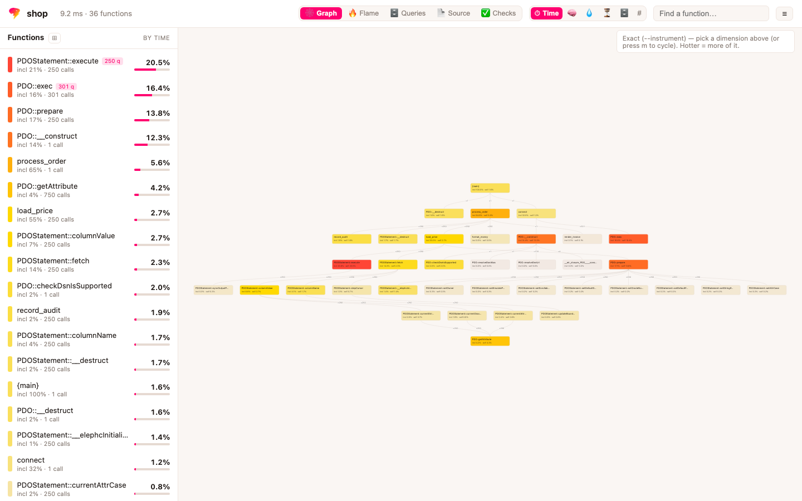

The top bar holds the view, the dimension and the search box. Settings you change rarely are behind the **menu** button. Hover any control to see what it does.

**Views** are ways to read one capture. The page offers only the views a capture supports.

| View | Shows |
|---|---|
| **Graph** | who calls whom, one card per function |
| **Flame** | every call on a time axis, or the call tree merged into bars |
| **Queries** | every distinct DB statement, with run counts |
| **Source** | your PHP file, annotated |
| **Checks** | the performance budget and what the run measured |

**Dimensions** recolour the graph and re-sort the list: time, memory, retained, wait, SQL, network, network wait, calls. A capture offers only the dimensions it measured.

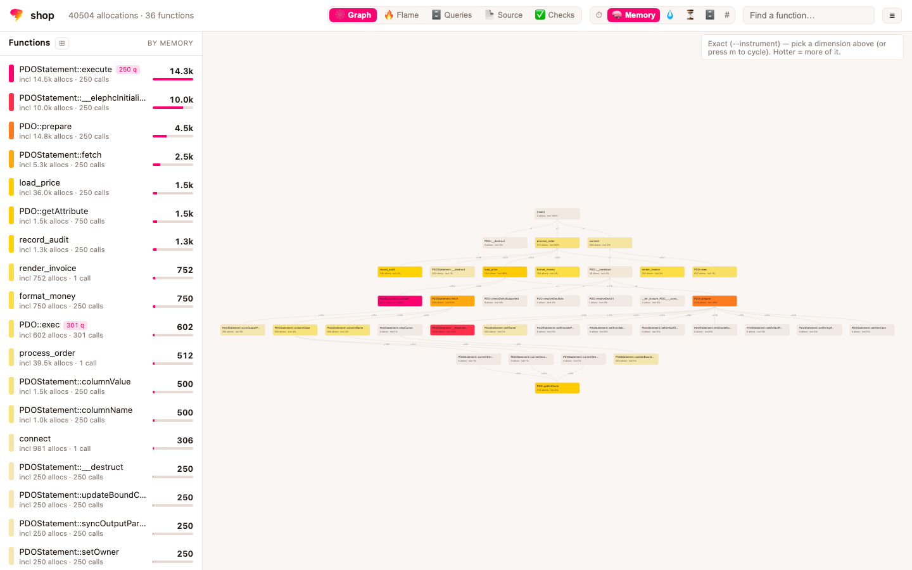

### The Functions list

The side list ranks functions by the current dimension. You can search it, resize it and group it under classes and namespaces.

The **Self / Inclusive** switch picks the cost the list ranks by:

| Choice | Ranks by |
|---|---|
| Self | a function's own cost |
| Inclusive | its own cost plus everything it calls |

- The figure on each row and each graph card follows the switch. The other figure sits beside it.
- Heat colour always follows the own cost.
- The choice is kept. A shared link carries it as `#sc=incl`.

Select a function to open it in place. You see its inclusive and own cost in every dimension the capture has. Then pick **Callers** or **Callees**. The choice is kept from one function to the next. Each entry shows its call count and the time it contributes.

- Click an entry to open that function.
- Click *In the graph* to centre the graph on it.
- Click the row again to fold it.
- Panning the graph keeps the selection.

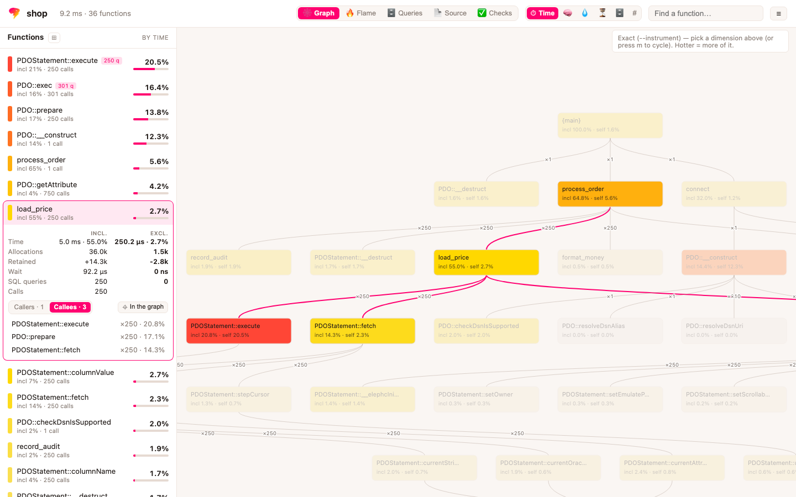

### Graph

Each function is a white card. A heat gauge on its left fills further, from gold to magenta, as the function's own cost grows. The card shows the name, the figure and a bar. A long name keeps its method and loses its namespace first.

- Hover a card for its metrics and cause bars.
- Click a card to isolate its callers and callees.
- Zoom and pan freely. The graph frames itself on arrival and after a resize, until you move it. Then your view is kept.
- A graph too big to fit at a readable size opens on the top of the tree, centred on its entry point. **Fit in view** (`0`) shows all of it.

The page follows the system light or dark setting unless you pick one in the menu. On a dark ground a quiet function is a dark card. The hot end stays gold to magenta.

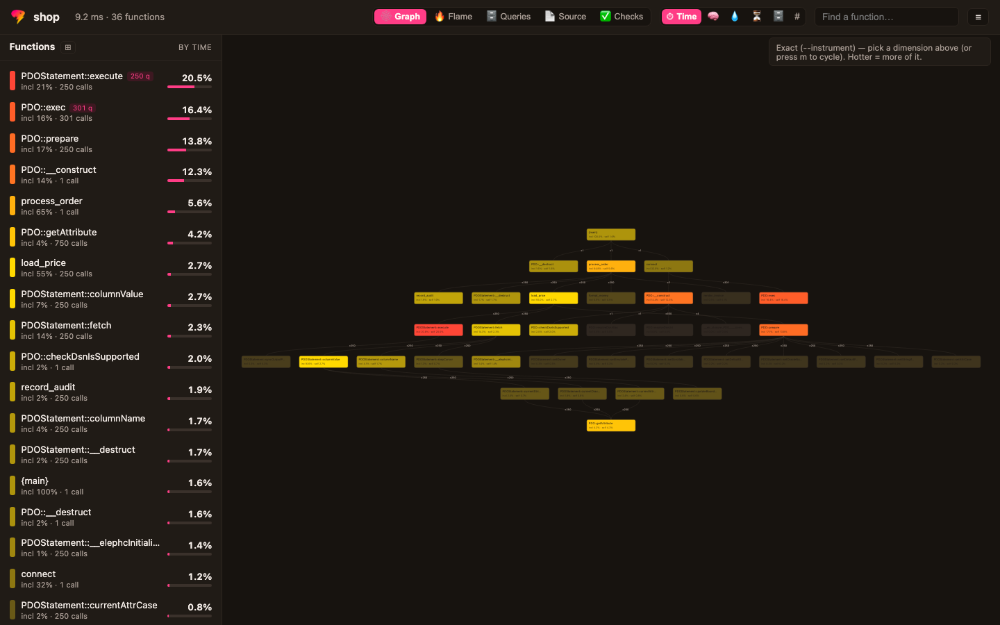

### Flame

Press `f`. Flame has two modes.

**Timeline** is the default for a launched run. It draws every call where and when it ran.

- Rows are call depth, on a time axis. Each call uses its function's heat.
- The memory the heap held, in bytes, is an area behind the calls. Its scale is on the left.
- An overview of the whole run sits on top. Drag across it to pick a range.
- Click a call to zoom on it. You see its wall time, its own time, and how much memory it took or gave back.
- Zoom with the wheel. Click **Whole run** or press `Esc` to come back.
- A run with more than 60 000 calls keeps the longest ones and says how many it shows.

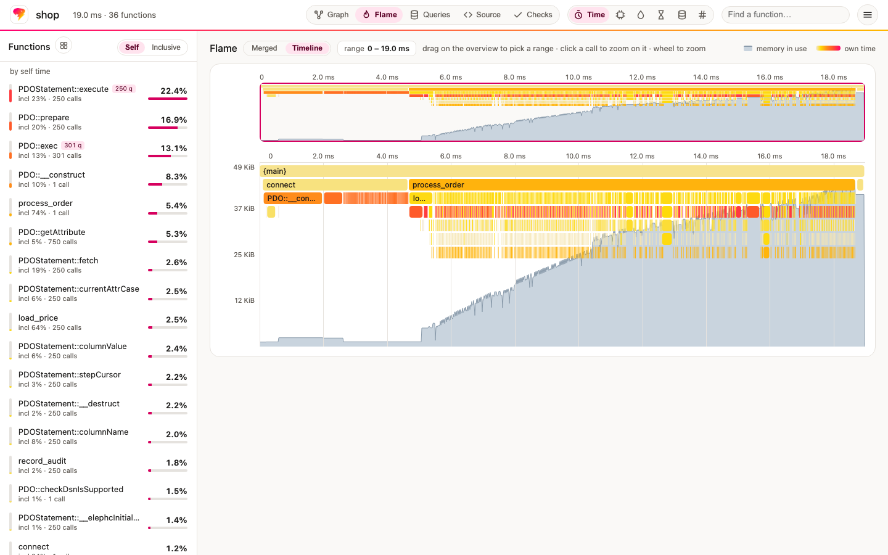

**Merged** is the icicle. All calls of a function under one caller fold into one bar. A child's width is its share of its parent's time. Click a frame to zoom into its subtree. Click **Back to all roots** or press `Esc` to zoom out. A link with `fm=merged` opens this mode.

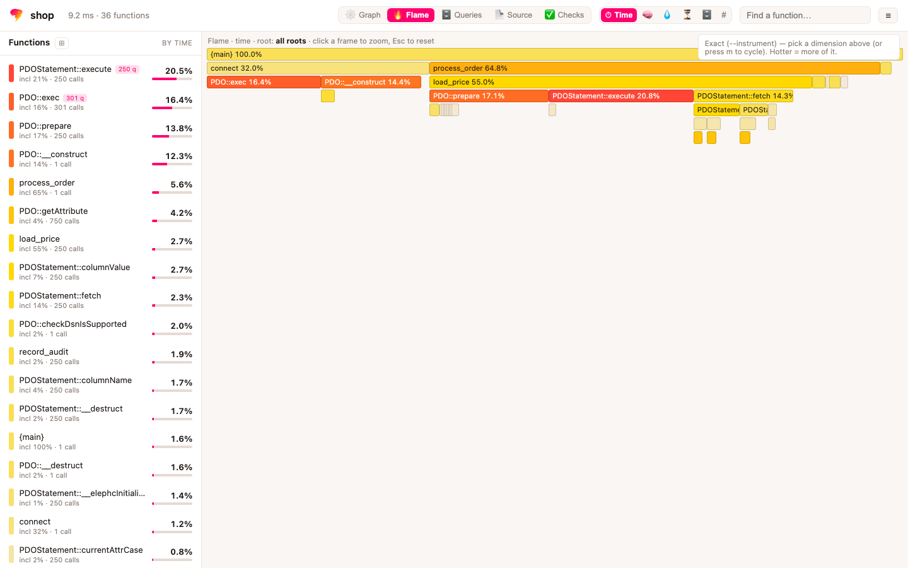

### Queries

Press `q`. The panel lists every distinct SQL statement with its exact run count. Literals are replaced by `?`, so 200 runs of the same statement fold into one row. A statement that ran many times gets an `N+1?` flag.

```text
Runs                     Statement
×200   ████████████████  SELECT name FROM users WHERE id = ?   N+1?
×200   ████████████████  INSERT INTO users (name) VALUES (?)   N+1?
×1     ▏                 CREATE TABLE users (id INTEGER …, name TEXT)
```

Click a statement to see which application functions ran it. A function is the first frame above the PDO or mysqli driver's own methods. Each one shows:

- the file and line of its declaration,
- how many of the statement's runs it made,
- its share of those runs.

Click a caller to open it in the function list.

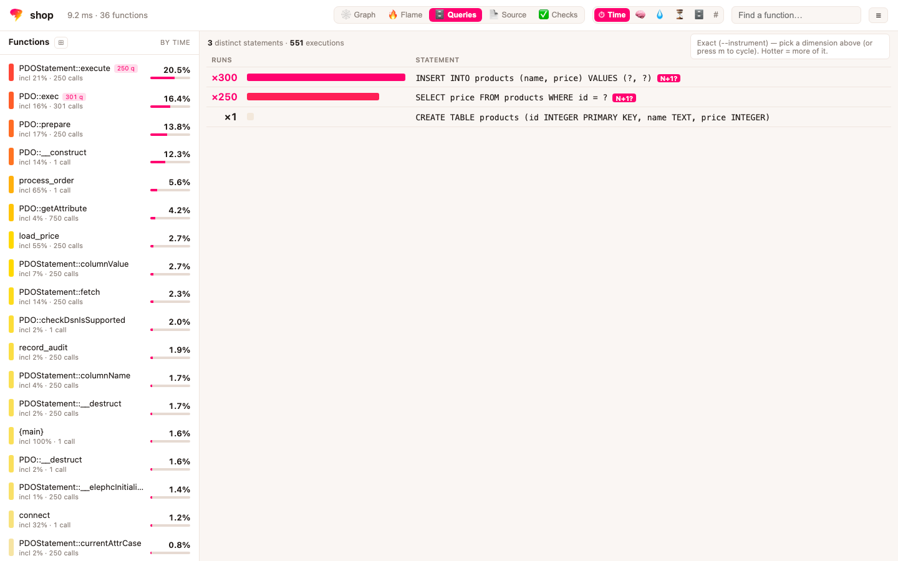

### Source

Press `s`. The view annotates your PHP file in one of two ways.

**Exact capture, per function.** Each declaration is labelled with its inclusive share and call count. Its body is tinted.

```text
 16   2.6%   function load_price(PDO $pdo, int $id): int {    incl 82.8% · 250 calls
 24   8.1%   function record_audit(array $log, ...): array    incl  8.1% · 250 calls
 30   0.5%   function format_money(int $cents): string {      incl  0.5% · 250 calls
 45   6.1%   function process_order(PDO $pdo, int $items)     incl 100.0% · 1 call
```

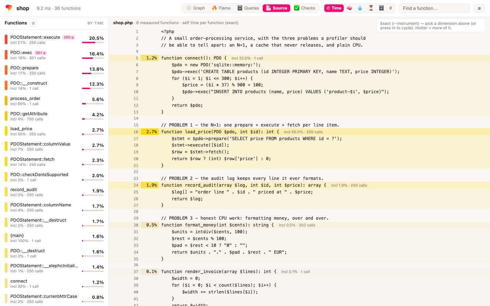

**Sampled capture, per line.** Each line shows the share of samples that landed on it, heat-coloured like the graph. This needs a macOS build with its `.dSYM` next to the binary.

```text
  5   1.2%   $row = [$id, $id * 7, $id % 5, $id + 1];
  6
  7  68.7%   for ($i = 0; $i < 300; $i++) { $s += $row[$i % 4] + $i; }
  8          return $s;
 ...
 17  30.1%   for ($i = 0; $i < $n; $i++) { $sum += strlen((string)($i * 2654435761)); }
```

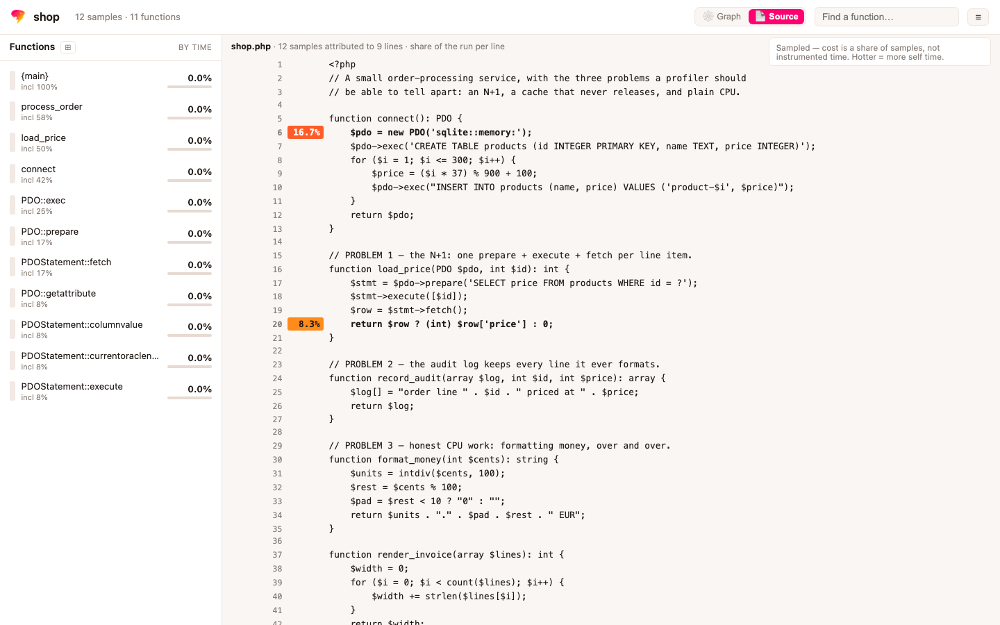

Per-line shares are always sampled. A line with a large share is hot. A line at 0% was never caught, which does not prove it is free. Per-function costs in the same panel are exact.

### Checks

Press `c`. The panel lists each assertion with its measured value beside its budget. See [Recommendations and assertions](#recommendations-and-assertions).

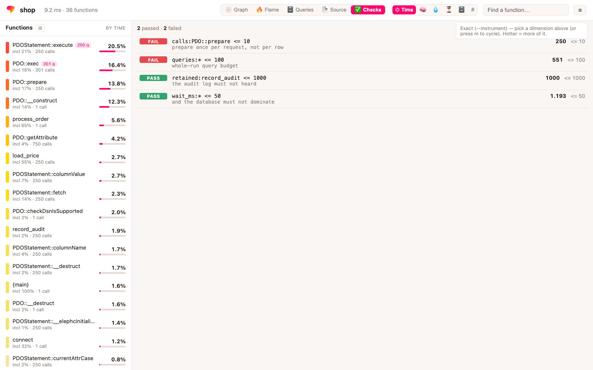

### The menu

| Item | Does |
|---|---|
| Start over | back to the timed graph, nothing selected or filtered |
| Fit in view | frames the whole graph |
| Critical path | highlights the heaviest root-to-leaf chain for the current dimension |
| Pruning threshold | All, 1%, 5% or 10%, to hide the small |
| Theme | Auto, Light or Dark |
| Shortcuts | the sheet below |

On a monitor page that has no profile yet, the menu holds only the theme.

### Keyboard

| Key | Does | Key | Does |
|---|---|---|---|
| `m` | cycle dimension | `f` | flame |
| `q` | queries | `s` | source |
| `c` | checks | `p` | critical path |
| `0` | fit in view | `r` | start over |
| `d` | diff vs previous | `l` | follow live |
| `←` `→` | scrub captures | `?` | shortcut sheet |
| `Esc` | zoom back out | | |

## Live and running programs

### Watch a program live

```bash
elephc monitor hot.php --live
```

`--live` launches the program and shows a top-style table. It refreshes once per window (`--duration`, default 3 s) and shows trend arrows against the previous window and a cumulative share. A final cumulative table prints on exit.

A live capture is sampled. It estimates, and it cannot see time spent blocked on I/O. It works on every platform.

Add `--html` to get a moving call graph:

```bash
elephc monitor app.php --live --html live.callgraph.html
```

- Open the file in a browser and leave it. It reloads as new windows arrive.
- The page keeps the last 10 captures. A timeline at the bottom scrubs them with the arrow keys, or click a pill. Each pill is tinted by how hot that window ran.
- `l` follows the newest capture or pauses on the one you study.
- `d` outlines every function whose self time grew since the previous capture.
- All captures share one layout, so a function keeps its position while you scrub. Your selection, pan and zoom survive each update.

To avoid full reloads, serve the page:

```bash
elephc monitor app.php --live --html live.callgraph.html --serve 127.0.0.1:9000
# then open http://127.0.0.1:9000/
```

Served over HTTP, the page merges new captures in place without a reload. The server has one resource, the graph. Bind a loopback address unless you mean to expose the profile.

### Attach to a process

```bash
elephc monitor --attach <pid> --live
```

`--attach` profiles a process that is already running. Ctrl-C stops monitoring and leaves the process running. A `--web` prefork server is measured across all its workers, because `--attach` discovers the worker children and merges them.

It reads the process from the outside, so it needs three things:

| Need | Detail |
|---|---|
| Symbols | Build the target with `--keep-symbols` (or `--debug-info`). Attaching to a stripped binary says so. |
| Permission | On Linux, `yama/ptrace_scope` often restricts attaching. The refusal names the setting. In a container, add `--cap-add=SYS_PTRACE` and a seccomp profile that allows `ptrace`. |
| Frame pointers | Stacks are walked through the frame pointer. A broken chain ends there. |

On macOS `--attach` uses `/usr/bin/sample`. On Linux elephc stops each thread with `ptrace` itself. Each stop wait is bounded to 50 ms per thread, so the first window can be slow when many threads are blocked.

If you cannot meet these needs, use the endpoint described next.

### Profiling something that is already running

Use the same command with an address instead of a path. Three steps are separate:

1. Compile with `--with-monitoring`. The binary gets the capability and a build key.
2. Start it with `ELEPHC_PROBE_ADDR`. That opens the endpoint.
3. Read it with `elephc monitor <address>` and the key.

```console
$ elephc build --with-monitoring service.php
probe build fingerprint: 9b28f463
Compiled 'service.php' -> 'service'

$ ls service*
service   service.key   service.php          # a binary and a key. No socket.

$ ELEPHC_PROBE_ADDR=/tmp/app.sock ./service &        # now the endpoint opens

$ elephc monitor /tmp/app.sock --key service.key
connected to probe build 9b28f463
samples: 86
...
```

The fingerprint printed at compile time and on connecting must match. It confirms that you reached the build you meant.

`ELEPHC_PROBE_ADDR` also accepts `host:port`:

```bash
ELEPHC_PROBE_ADDR=127.0.0.1:9411 ./app                 # on the server

elephc monitor 127.0.0.1:9411 --key app.key            # sampled, from your machine
elephc monitor 127.0.0.1:9411 --key app.key --exact    # the next request, exactly
```

#### The key

`--with-monitoring` creates a 32-byte build key, embeds it in the binary, writes it to `<binary>.key` and prints its public fingerprint. Keep the sidecar as secret as a `.env` file.

`monitor <address>` takes the key from one of:

- `--key <file>`,
- the `ELEPHC_PROBE_KEY` environment variable (hex),
- a `.key` sidecar next to the socket.

The client and the server prove to each other that they hold the key. A client that cannot prove it is disconnected before any sample is sent. The profile crosses the connection encrypted.

Setting `ELEPHC_PROBE_ADDR` only opens the endpoint. It does not start collection. A service nobody asked arms no timer, fills no ring and prints nothing.

If the address is a path and the bind fails, the program says so on stderr. Socket paths are limited to about 104 bytes, so keep them in `/tmp` or `/run`.

For `https://`, the endpoint must sit behind a TLS terminator such as a reverse proxy or tunnel. The probe listener itself does not speak TLS. The certificate is checked against the system roots, and a self-signed or expired one stops the connection.

#### Two answers

| Command | Answer |
|---|---|
| `elephc monitor host:9411 --key app.key` | sampled: what the process is doing now |
| `elephc monitor host:9411 --key app.key --exact` | exact: the next request that completes |

- **Sampled.** Collection starts when you first ask. The first answer on an unasked service can be thin or empty. Ask again.
- **Exact.** It waits up to 30 seconds for the next request. One exact capture runs at a time. If it cannot answer, the reply says why: someone else is asking, nothing completed in time, or the profile was too large to hand over.
- **Exports.** The exact answer is the table only. The exporters (`--out`, `--pprof`, `--dot`, `--html`) read the sampled capture. `--exact` with one of them is refused.

### One request in production

A `--web` service also accepts a signed `X-Elephc-Query` header. It profiles that single request and leaves every other one alone.

```text
X-Elephc-Query: t=<unix seconds>,v=<hex hmac of the timestamp>
X-Elephc-Query: t=<unix seconds>,n=<request id>,v=<hex hmac of "<t>.<n>">
```

- The header is signed with the build key.
- It is single use. Once honoured, the value is spent for every worker.
- The timestamp must be within five minutes of the server's clock.
- Use the second form when you profile more than once a second. `n` is a request id or UUID of up to 64 characters from `A-Za-z0-9-_`. It is part of the signed text.
- An invalid, spent or missing value profiles nothing. The request runs as usual.
- Two signatures can collide in the 4096-slot spent table. The second is then refused (one chance in 4096). A service whose shared mapping could not be set up refuses every signed header.

### `--web` servers: all workers, per route

Under `--web`, every worker samples into one shared ring. One connection sees the whole server.

Samples taken while a worker handles a request carry the request route as the outermost frame. The table, the flame graph and the pprof export group by endpoint:

```text
GET /api/orders   ██████████████████████ 98.4%
  {main}  serialize  <native>...
```

The label is a shape, not a path. Path segments that cannot be route names are replaced:

| Segment | Becomes |
|---|---|
| only digits | `{id}` |
| a UUID | `{uuid}` |
| 12 or more hex characters | `{hash}` (per dot-separated part) |
| anything else | kept as is |

So `/users/1` and `/users/2` share the row `GET /users/{id}`. `/assets/app.9f8c2b1a4d5e.js` reads as `/assets/app.{hash}.js`.

- The route table holds 255 shapes plus one `<other>` bucket. The surplus goes to `<other>` and is not dropped.
- Route names are sanitized. A `;` or a newline in a crafted path cannot forge frames.
- Nothing is recorded until someone asks for a profile. A service started with [`--apm`](apm.md) names routes from its first request instead, because it counts every request from boot. A "not found" answer interns nothing.

To know which routes are slow, failing or busy over hours and days, use [Transaction monitoring](apm.md).

## In CI

### Recommendations and assertions

`monitor` ends with a **recommendations** section. It lists:

- the time hotspot and the allocation hotspot,
- functions whose per-call cost hints at call overhead,
- **N+1** shapes: a callee invoked many times by one caller, especially when it touches the database,
- retained objects, for example *`hoard` retains the most: 20001 of its 20014 allocations (100%) are still live when it returns*,
- I/O-bound runs, when a quarter or more of the run is spent waiting on the database.

An N+1 reads like this: *`list_all` calls `get_user` 200 times and `get_user` issues 200 DB queries. Batch them into one query.* The counts are exact.

To gate a build, add assertions. Each `--assert <metric>:<fn><op><value>` is checked against the exact profile. Any failure exits with status 2.

```bash
elephc monitor app.php \
  --assert 'calls:render<=1' \
  --assert 'self_ms:parse<10' \
  --assert 'allocs:build<=5000'
```

Use `*` as the function to assert on the whole run:

```bash
elephc monitor app.php \
  --assert 'queries:*<=50' \
  --assert 'wait_ms:*<=5'
```

| Metric | Measures |
|---|---|
| `calls` | invocations |
| `allocs` | heap allocations |
| `retained` | allocated minus freed objects (can be negative) |
| `queries` | DB queries |
| `self_ms` | own wall time |
| `incl_ms` | inclusive wall time |
| `wait_ms` | time blocked in DB driver calls |
| `network` | outgoing network operations |
| `network_wait_ms` | time blocked in curl |
| `time_pct` | share of the run |

Operators are `<=`, `>=`, `==`, `<` and `>`. Because the numbers are exact, an assertion such as "at most one call to `render`" is not flaky.

### A budget per project

Keep the budget in the `[budgets]` table of the project's `elephc.toml`. This is the file that already holds [native dependencies](../compiling/native-dependencies.md) and [`[ini]` directives](../compiling/cli-reference.md#in-the-project-file).

```toml
# elephc.toml: performance budget for the order service.
# One rule per string: <metric>:<function><op><value>.
# `*` targets the whole run. Text after `#` labels the rule.
[budgets]
rules = [
  "calls:PDO::prepare <= 10     # prepare once per request, not per row",
  "retained:record_audit <= 1000 # the audit log must not hoard",
  "queries:* <= 100             # whole-run query budget",
  "wait_ms:* <= 50              # and the database must not dominate",
]
```

- The file is found by walking up from the profiled source. The working directory does not matter.
- `--assert-file <path>` names a budget file explicitly.
- `--assert` flags still apply on top.
- The syntax is the same as the flag. The label after `#` says why a budget exists.
- An older `.elephc` file (one assertion per line) is still read when `elephc.toml` has no `[budgets]` table. A note asks you to move it.

The report lists failures first:

```text
assertions — 3 passed, 3 failed, 1 not evaluated
  [FAIL] calls:PDO::prepare    <= 10 (actual 250)  — prepare once per request, not per row
  [FAIL] retained:record_audit <= 1000 (actual 31625)  — the audit log must not hoard
  [FAIL] queries:*             <= 100 (actual 551)  — whole-run query budget
  [SKIP] calls:nonexistent     <= 1 ('nonexistent' never ran)
  [PASS] wait_ms:*             <= 50 (actual 2.034)  — and the database must not dominate
```

`SKIP` means the budget names a function the run never reached, or a metric that does not exist. It still fails the gate. A budget that measures nothing is a mistake.

### Before and after

```bash
elephc monitor app.php --save before.json                    # once, on main
# ... change the code ...
elephc monitor app.php --baseline before.json \
                       --fail-on-regression 5                # in CI
```

- `--save` stores a capture. `--baseline` reads one back and prints a per-function delta table with time share and call count, before and after.
- `--fail-on-regression <points>` exits with status 2 when any function's share grew by more than that many percentage points.
- Add `--html diff.html` for a two-frame diff graph. Scrub between baseline and current. The diff toggle (`d`) lights up every function that grew.
- With exact captures, a call-count change of `+1` is a real `+1`.
- A Speedscope file from `--out` is for reading, not comparing. Passing one as `--baseline` fails the command.
- Compare captures of the same kind. A `.php` capture recovers inlined frames that a bare-binary capture cannot, and the asymmetry shows as false deltas.
- Sampled captures carry noise of about 0.3 points at 1 500 samples. Thresholds of a few points are well clear of it.

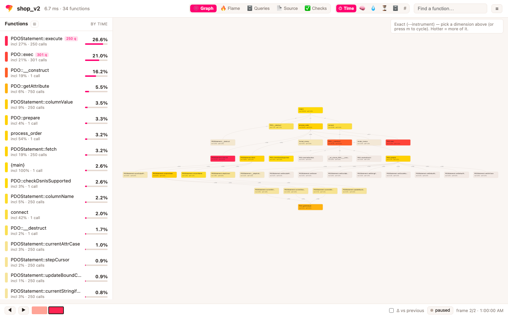

## Exports

| Flag | Writes | Opens in |
|---|---|---|
| `--out <file>` | Speedscope JSON | speedscope.app |
| `--pprof <file.pb.gz>` | pprof profile | `go tool pprof`, Pyroscope, Parca |
| `--dot <file>` | Graphviz call graph | `dot`, any DOT reader |
| `--html <file>` | self-contained call graph page | any browser |
| `--trace <file>` | Chrome Trace Format timeline | ui.perfetto.dev, `chrome://tracing` |
| `--stitch <log>` | distributed trace report | terminal, `--html`, OTLP, Prometheus |

`--dot`, `--html`, `--pprof` and `--out` also work against a running service.

### Speedscope

The Speedscope file has two views. **PHP (helpers folded)** shows only your functions. **Why (runtime)** keeps the helper frames, each annotated with its cause.

### pprof and Pyroscope

```bash
elephc monitor app.php --pprof app.pb.gz
go tool pprof -top app.pb.gz            # or upload to Grafana Pyroscope / Parca
```

The route is the outermost frame of each stack, so a flame graph groups by endpoint.

To send the profile to an OpenTelemetry backend, use the Collector's `pprof` receiver with the file `--pprof` writes:

```yaml
receivers:
  pprof:
    endpoint: 127.0.0.1:4319
service:
  pipelines:
    profiles:
      receivers: [pprof]
      exporters: [otlp]
```

### Call graph (DOT)

```bash
elephc monitor app.php --dot app.callgraph.dot
dot -Tsvg app.callgraph.dot -o app.callgraph.svg
```

### Timeline for Perfetto

```bash
elephc monitor app.php --trace app.trace.json
# then open app.trace.json at https://ui.perfetto.dev (or chrome://tracing)
```

Each call becomes a nested slice, so you see the real order and duration of calls. A generator resumed three times appears as three slices on its own row.

To record from a monitored binary directly, set `ELEPHC_INSTR_TRACE=<path>` and, optionally, `ELEPHC_INSTR_TRACE_MAX=<n>`. The trace keeps at most 500 000 calls by default and reports the overflow.

### Distributed profiling with W3C Trace Context

Under `--web --with-monitoring`, each request is profiled as its own slice. The slice has a trace identity:

```text
elephc-instr-trace: trace=35bd350e10388a888de06d4020ca84fa span=acef53ab67c88954 parent=-
```

elephc uses the standard [W3C Trace Context](https://www.w3.org/TR/trace-context/) `traceparent` header.

- A request with a valid `traceparent` continues that trace as a child span. Otherwise a new trace starts.
- A malformed header always starts a new trace.
- The caller can be any OpenTelemetry service, Jaeger, Datadog, nginx or another elephc binary.
- Curl forwards the trace to the next service automatically while a capture is active. A `traceparent` header you set yourself wins.
- For other HTTP clients, read `ELEPHC_TRACEPARENT`. It is refreshed at the start of every captured request and carries this slice's span id.

```php
$ctx = stream_context_create(['http' => [
    'header' => "traceparent: " . getenv('ELEPHC_TRACEPARENT') . "\r\n",
]]);
$fh = fopen('http://inventory.internal/stock', 'r', false, $ctx);
```

The result across two elephc services and an external caller:

```text
caller (any OTel service)  trace=1111…8888  span=aaaabbbbccccdddd
  service A                trace=1111…8888  span=604e39a69a8d26e2  parent=aaaabbbbccccdddd
    service B              trace=1111…8888  span=13b8fb9994026a78  parent=604e39a69a8d26e2
```

#### Correlating the services

Collect each service's stderr and pass the logs to `--stitch`. It captures nothing itself. It correlates slices that are already recorded.

```bash
elephc monitor --stitch gateway.log --stitch inventory.log
```

```text
distributed traces — 3 trace(s) over 9 slice(s)

trace 1a03577bf4ef56af5d28e7932937e56f
● gateway  8.9 ms  ████████████  2 fn
  └─ inventory  2.2 ms  ···███░░░░░░  1 fn
  └─ inventory  2.3 ms  ·········███  1 fn
```

Each line is a span: the service (named after its log file), its duration, its share of the trace and its function count. When non-zero, it also shows query count and wait. The bars are a waterfall. A leading `·` is time before the span started. Two hops in sequence step to the right. Two overlapping hops share a starting column. A span whose parent is missing from the logs is shown as a root.

The report opens with a per-service summary:

```text
per service

service                               n        p50        p90        p95        p99      rps    q/req    wait
gateway · GET /                      25     5.2 ms     5.6 ms     5.9 ms     6.1 ms    144.6      0.0      0%
inventory · GET /                    50     1.3 ms     1.4 ms     1.4 ms     1.5 ms    292.6      0.0      0%
```

- Rows split per endpoint when every slice names one.
- Percentiles are nearest-rank. Each is a duration some request really took.
- Under 20 requests the report says so, because the upper percentiles are then only the slowest requests.
- The rate is omitted when slices carry no timestamps or all share one instant.

Add `--html` for a chart. Each span is placed by when it opened and sized by how long it ran. Open a row to see that service's hottest functions.

```bash
elephc monitor --stitch gateway.log --stitch inventory.log --html trace.html
```

The axis is wall clock, so clocks that drift apart can show a hop starting slightly before its parent. A trace is placed on the axis only when every span in it has a timestamp. Otherwise the whole trace falls back to duration-only bars.

#### Sending it to OpenTelemetry

```bash
elephc monitor --stitch gateway.log --stitch inventory.log \
               --otlp http://127.0.0.1:4318 --prometheus elephc.prom
```

- `--otlp` posts the slices as OpenTelemetry spans. Each span carries its duration, route, query count, network-operation count and wait.
- Use plain HTTP to a local agent. An `https` endpoint is refused with advice to put a sidecar in front.
- Slices without timestamps are skipped and counted.
- Profiles are not exported over OTLP. Use the `--pprof` file with the Collector as shown above.
- `--prometheus <file>` writes per-service stats in the text exposition format, for a textfile collector. Percentiles are a `summary`. Network data is exported as the `elephc_network_operations_per_request` and `elephc_network_wait_seconds_per_request` gauges.

### Exact call counts

For exact per-function call counts without the full profiler, compile with `--counters`:

```bash
elephc --counters app.php
./app          # prints, to stderr at exit:
# elephc-counters: hot_leaf 40
# elephc-counters: call_hot 0
```

Each PHP function gets one counter incremented in its prologue. A fully inlined call keeps its counter at zero. A zero next to a hot sampled function shows that it was inlined.

## Reference

### What the numbers are

A launched run is exact. The binary counts every call and times it between enter and exit.

| Field | Meaning |
|---|---|
| calls | the true invocation count |
| inclusive time | wall time from enter to exit. Recursion counts the outermost activation only. |
| self (exclusive) time | inclusive time minus the callees' |
| allocations | heap allocations, inclusive and self |
| retained | allocated minus freed, signed. A function that releases more than it takes reports a negative value. |
| queries | PDO statement executions and `PDO::exec` |
| wait | time blocked inside DB driver calls, across every driver |
| network, network wait | curl transfers, and time blocked in curl |

Self times add up to the root's inclusive time. Allocation counts partition the same way.

Two dimensions can disagree. A function can allocate most and retain little, while another keeps what it allocates:

```text
churn   incl 100.0%  self 100.0%  calls 1  allocs 40001  retained     +2
hoard   incl  98.7%  self  98.7%  calls 1  allocs 20014  retained +20001
```

Wait lets you tell slow PHP from a slow database:

```text
PDO::exec              self 1.8 ms   wait 1.4 ms   non-DB 363.7 µs
PDOStatement::execute  self 2.9 ms   wait 167.0 µs non-DB 2.8 ms
PDO::prepare           self 2.1 ms   wait 0 ns     non-DB 2.1 ms
```

`PDO::exec` above is the database. `PDO::prepare` is mostly PHP. The non-DB remainder is not an OS measurement of on-CPU time.

Network counters are separate from the PDO ones, so HTTP-heavy requests do not trigger a false N+1. `curl_upkeep()` adds wait but is not a transfer. PHP callbacks nested inside `curl_exec()` are subtracted from network wait.

**Sampled** captures come from a service's endpoint, from `--live` and from `--attach`.

- They are estimates that sharpen as samples accumulate.
- They carry noise of about 0.3 points at 1 500 samples.
- They count CPU time only. They cannot see time blocked on I/O.
- `--attach` carries no sampled allocation deltas and no route tags.
- A binary built with the combined `--with-monitoring` gives no per-route query or wait summary in the sampled answer. Ask for it with `--exact` or with a signed header.
- On Apple `arm64e` builds, PAC-signed return addresses reduce sampled stacks to `<native>`. The default `arm64` target is not affected.

A sampled stack can be shorter than the real one. What it shows did run.

#### Limits of "exact"

| Case | What happens |
|---|---|
| Frames deeper than 65 536 | Calls are counted but not timed. `monitor` says how many. |
| Exceptions | Frames are closed at the throw. The catcher gets the handler's time and allocations. |
| Run shorter than 100 µs on a machine without a published counter rate | The `_ns` columns are raw counter ticks, and `monitor` says so. ARM machines are not affected. |
| Inlined functions | They fold into their caller and do not appear. |
| No `{main}` selected | Shares are relative to the largest included function, and self shares can add up to more than 100%. |
| Generators and fibers | A suspended body is off the stack. Time between a suspend and a resume belongs to whoever drove it. |
| `yield from` | The inner generator is recorded as a callee of the consumer, not of the outer generator. Inclusive times are right. |
| Suspension from a nested call | Only the innermost frame is parked. The outer body keeps its frame. Suspending directly from the body, as every `yield` does, is exact. |
| More than 4 096 suspended coroutines | Further suspensions keep the old attribution. The report says how many. |
| File I/O | Not counted or timed. |
| Threads | Instrumentation is per thread and reports the main thread at exit. |

### Narrowing it to a few functions

```bash
elephc --with-monitoring=process_order,'PDOStatement::*' app.php
elephc --with-monitoring=@hot-functions.txt app.php
```

- Hooks go only on the functions you name.
- `{main}` names the top-level frame.
- A trailing `*` matches by prefix.
- `@file` reads one name per line.

A good way to build the list is to profile the whole program once and name the functions that dominate.

Selective runs change what "self" means. An uninstrumented callee runs inside its instrumented caller's frame. Its time lands in the caller's self, and self values no longer add up to the root's inclusive. Every selective run prints:

```text
elephc-instr: note: selective instrumentation — self time includes any
uninstrumented callees, so self values do not sum to the root's inclusive
```

### What it costs

The cost is about 30 ns per profiled function call. It is nothing the rest of the time.

On the demo service (35 instrumented functions, about 550 queries, 135 351 profiled calls in a quarter of a second):

| | CPU time | overhead |
|---|---|---|
| built without it | 247 ms | none |
| `--with-monitoring`, nobody asked | 247 ms | +0% |
| `--with-monitoring`, profiling | 254 ms | +3% |
| `--with-monitoring=` 3 functions, profiling | 251 ms | +2% |

The binary grows by 219 KB (38.1 to 38.3 MB, +0.6%).

- A dormant binary pays one flag check per call. That is below what the measurement resolves. This holds for database work too.
- You pay the profiling cost only while a profile is taken: one run, or one request with the header.
- Do not carry the +3% to your program. Estimate `30 ns × your call count` instead, or measure it. A loop that is nearly all calls (two million calls in 130 ms) pays +48%.
- Naming fewer functions saves time in proportion to the calls it removes.

If you benchmark inside a clone of elephc, you will measure about seven times these figures. A source checkout links the debug build of the instrumentation, at about 165 ns per call. An installed elephc links the release build.

### Security model and caveats

- **Three triggers, each a credential.** Locally, the control channel that `monitor` hands the program it launched. Remotely, the 32-byte build key. Per request, a signed `X-Elephc-Query` header, good for one request and five minutes at most. No environment variable turns profiling on.
- **Anyone who can read the binary can extract the key.** On a host with untrusted local users, each of them holds the profiling credential for anything world-readable there. The `<binary>.key` file is written `0600` and a Unix probe socket is `0600`. The binary's own permissions are yours to set.
- **The seal covers the payload, not the connection.** A watcher learns that something profiled the process, when, and roughly how large the answer was.
- **`https://` needs a TLS terminator.** Put the endpoint behind a proxy or tunnel for transport protection on top of the sealed payload.
- **Unix socket paths are limited to about 104 bytes.**
- **Route names come from requests.** They are sanitized and shaped. The table holds 255 shapes plus `<other>`, and is not written until someone asks. A crawler cannot exhaust it or displace your endpoints. A service with `--apm` names routes from boot, but only once a request is answered with something other than 404, 405 or 410. Until then those requests count under one `<not found>` row.
- **Self re-exec.** A program that calls `execve` without forking keeps the armed sampling timer, which would kill the new image. Call the exported `elephc_probe_disarm` before such an exec. `exec()`, `proc_open` and `popen` fork first and are safe.
- **Exporters read the sampled capture.** `--exact` with `--out`, `--pprof`, `--dot` or `--html` is refused instead of being accepted and ignored.

### Options

| Option | Used with | Effect |
|---|---|---|
| `--with-monitoring[=<names>]` | `elephc` | embed profiling, for all or the named functions |
| `--keep-symbols`, `--debug-info` | `elephc` | keep symbols, needed by `--attach` |
| `--counters` | `elephc` | exact per-function call counters |
| `--html <file>` | `monitor` | interactive page |
| `--out <file>` | `monitor` | Speedscope JSON |
| `--pprof <file.pb.gz>` | `monitor` | pprof profile |
| `--dot <file>` | `monitor` | Graphviz graph |
| `--trace <file>` | `monitor` | Perfetto timeline |
| `--live` | `monitor` | top-style table, sampled |
| `--duration <seconds>` | `monitor --live`, `--attach` | window length, default 3 s |
| `--serve <host:port>` | `monitor --live --html` | serve the page |
| `--attach <pid>` | `monitor` | profile a running local process |
| `--key <file>` | `monitor <address>` | build key |
| `--exact` | `monitor <address>` | exact table of the next request |
| `--assert <expr>` | `monitor` | assertion, exit 2 on failure |
| `--assert-file <file>` | `monitor` | budget file |
| `--save <file>` | `monitor` | store an exact capture |
| `--baseline <file>` | `monitor` | compare with a saved capture |
| `--fail-on-regression <points>` | `monitor` | exit 2 when a share grows by more |
| `--stitch <log>` | `monitor` | correlate service logs (repeatable) |
| `--otlp <endpoint>` | `monitor --stitch` | send spans to OpenTelemetry |
| `--prometheus <file>` | `monitor --stitch` | per-service metrics |

| Environment variable | Effect |
|---|---|
| `ELEPHC_PROBE_ADDR` | opens the endpoint of a monitored binary |
| `ELEPHC_PROBE_KEY` | build key in hex, for `monitor <address>` |
| `ELEPHC_INSTR_TRACE`, `ELEPHC_INSTR_TRACE_MAX` | write a Perfetto trace from a monitored binary |
| `ELEPHC_TRACEPARENT` | the current request's `traceparent`, for other HTTP clients |

See the [CLI reference](../compiling/cli-reference.md) for the full flag list. To learn how the sampler and the instrumentation work, read [How it works](../internals/profiling.md).
